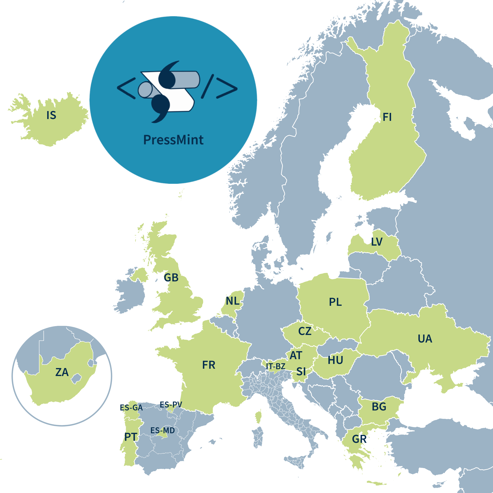

# PressMintMap
Map of countries and regions participating in the PressMint project

The map is built with a small reusable library (MintMap), so other projects (e.g. ParlaMint) can show their own countries by changing settings only.

## Layout

| path | content |
|---|---|
| `lib/map.js` | the map: `MintMap.render("#map", config)` - all options are documented at the top of the file |
| `lib/styles.css` | layout, controls and neutral default colors |
| `lib/map.mk` | make targets for projects (`map.png`, `serve`) |
| `lib/render-map.mjs` | renders a map page to PNG in headless Firefox |
| `data/europe.topojson` | prebuilt map data: countries of Europe, Asia and Africa, regions (admin-1) of all European countries, Crimea and Sevastopol as part of Ukraine |
| `pressmint/` | the PressMint map: `index.htm`, settings `pressmint.js`, colors `pressmint.css`, logo |

## Using the map

* click a highlighted country/region to select it, click any other country to mark it as a candidate (striped, with its code)
* **Share** copies a link with the current setup: `pressmint/index.htm?selected=PL,UA&candidates=DE&hide=regions,codes,logo`
* **Reset** returns to the default view, **SVG**/**PNG** download the map

## Make targets

| command | |
|---|---|
| `make data` | rebuild `data/europe.topojson` from Natural Earth (needs GDAL, jq, `npm install`) |
| `make all` | rebuild data and the PressMint preview `pressmint/map.png` |
| `make -C pressmint map.png` | rebuild the PressMint preview (needs Firefox, `npm install`) |
| `make -C pressmint serve` | serve the map at http://localhost:8000/pressmint/index.htm |
| `make viz-patch` | visual check of the Crimea/Sevastopol data patch |

## New project (e.g. ParlaMint)

Copy `pressmint/` and change `config` in the `.js` file (highlighted countries/regions, fitted countries, insets, logo) and colors in the `.css` file. In a separate repository, add this repository as a git submodule and adjust the paths to `lib/` and `data/`.
